# Devops Lab Exam - CIA - 2

**Aadithyaa R**
**23011102003**

## 1. Setup and Execution Instructions

Here are the commands required to build, test, package, and deploy the application locally:

**Build, Test, and Package (Maven):**

```bash
mvn clean test
mvn package
```

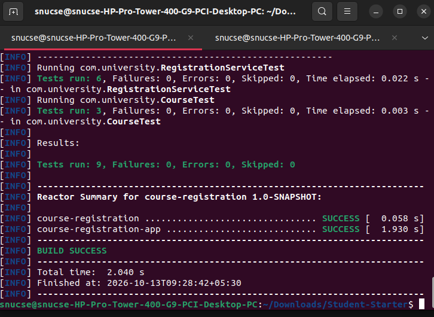

**Deploy (Kubernetes):**

```bash
# Start Minikube
minikube start

kubectl apply -f deployment.yaml
kubectl apply -f service.yaml
```

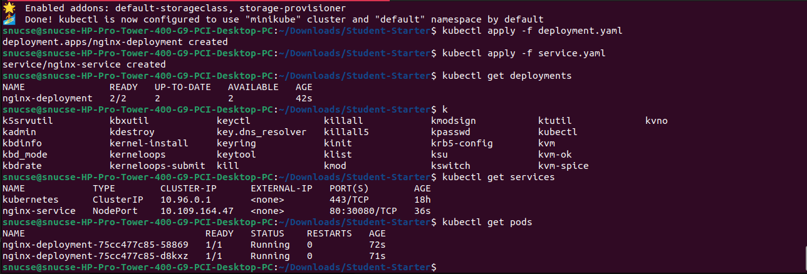

## 2. Git Evidence

All developments were safely isolated in a feature branch before being merged into main.

- **Feature Branch Name:** `feature/course-updates`
- **Change Summary:** Refactored into a Maven multi-module structure, changed a capacity boundary bug, implemented a 1-6 credit validation, created a Jenkins pipeline, and containerized the app for Kubernetes deployment.

**Commit History:**

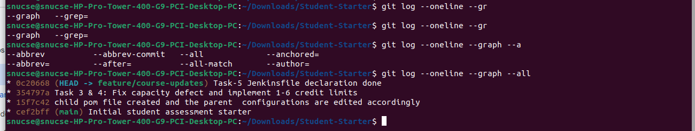

## 3. Maven Configuration & Build Evidence

I broke the monolithic repository down into a clean Parent-Child architecture.

- **Parent-Child POM Structure:** The root `pom.xml` acts like the parent. It manages the properties and uses `<dependencyManagement>` and `<pluginManagement>` to centralize versions. The child POM (`course-registration-app`) inherits these configurations without  versions, which keeps things  for future microservices.

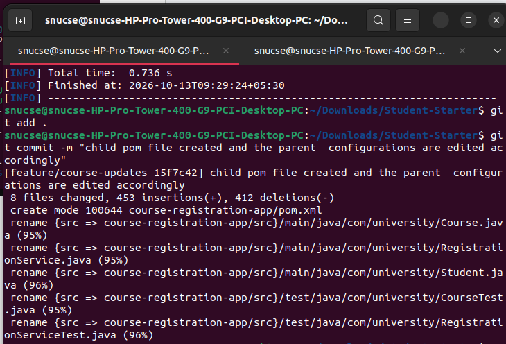

- **Build/Test Results:** All JUnit 5 validations pass successfully.

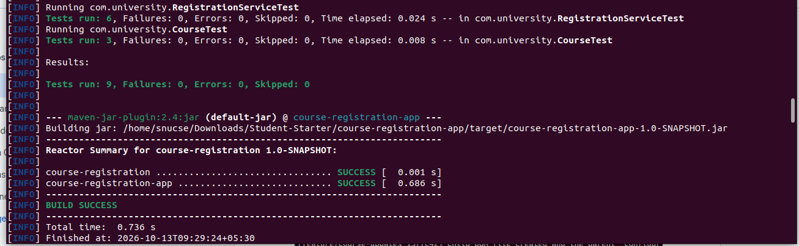

## 4. Jenkins Pipeline Explanation

I wrote a Jenkinsfile to handle Continuous Integration.

- **Test Reporting:** I used a `post { always { ... } }` block with the `junit` step pointing to `course-registration-app/target/surefire-reports/TEST-*.xml`. What happens here is once the build is done in Jenkins, it will be seen in detail in the Jenkins console whether it is successful or not.

- **Preventing Bad Artifacts:** The pipeline runs `mvn test` in the Test stage. Because pipelines fail fast by default, if a JUnit test fails, the `mvn test` command exits with a non-zero status code. This immediately halts the pipeline, completely preventing it from moving on to any subsequent `mvn package` or artifact archiving stages, ensuring broken code never gets deployed.

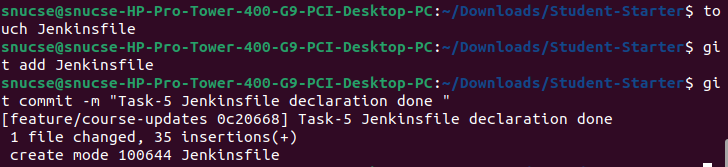

## 5. Kubernetes Deployment Evidence

The application runs on a local Minikube cluster using standard YAML manifests.

**1) deployment.yaml**

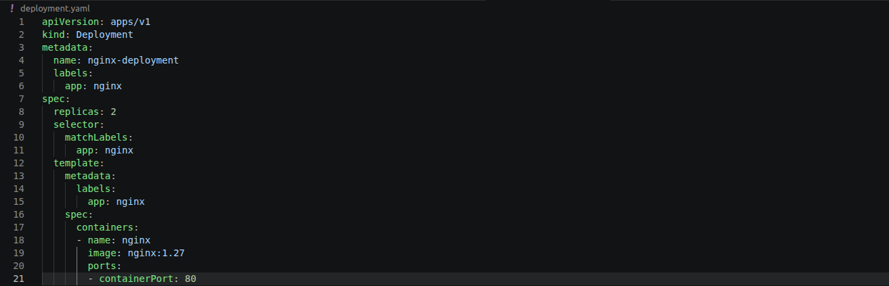

**2) service.yaml**

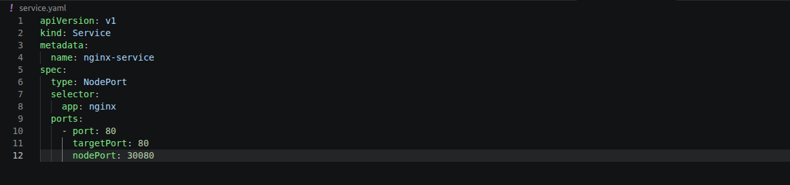

**Scaling and Self-Healing Evidence:**

When I scaled the deployment to 3 replicas and forcefully deleted pod `58869`, the Kubernetes control plane instantly detected the drift and spun up `xhfk7` to maintain the 3-replica state.

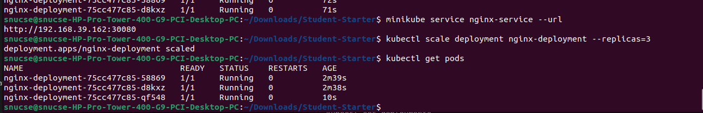

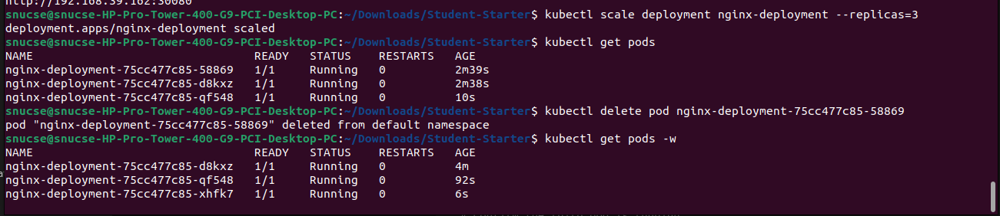

## 6. Change Summary and Limitations
- **Modified Files:**
  - `pom.xml` (Root)
  - `course-registration-app/pom.xml` (New)
  - `course-registration-app/src/main/java/com/university/RegistrationService.java`
  - `course-registration-app/src/test/java/com/university/CourseRegistrationServiceTest.java` (New tests added)
  - `Jenkinsfile` (New)
  - `deployment.yaml` (New)
  - `service.yaml` (New)

- **Known Limitations:**
  - The system currently stores all data in memory. State is lost if the application restarts. we need to have docker images for this
  - we are doing it in a miniube , which is not industry standard
  - The Kubernetes deployment currently pulls a Nginx image rather than a Docker image of our Java application due to local registry. 
  - The jenkins build is not verified via the browser , we should need github access to send out github url aas string parameter , so that with scm polling the jenkins can access the push changes and edit accordingly


## 7 . Acceptance Criteria - Valid course-credit range

- **Edited the test cases to satisfy all the conditions:** The original test didnot have for less than 0 and greater than 7 , so i have implemented the boundary conditions and the junit focused to the given constraints .  I made those and the corresponding tests are also verified proerly after commiting all the iles , just to make sure that there are no local build.


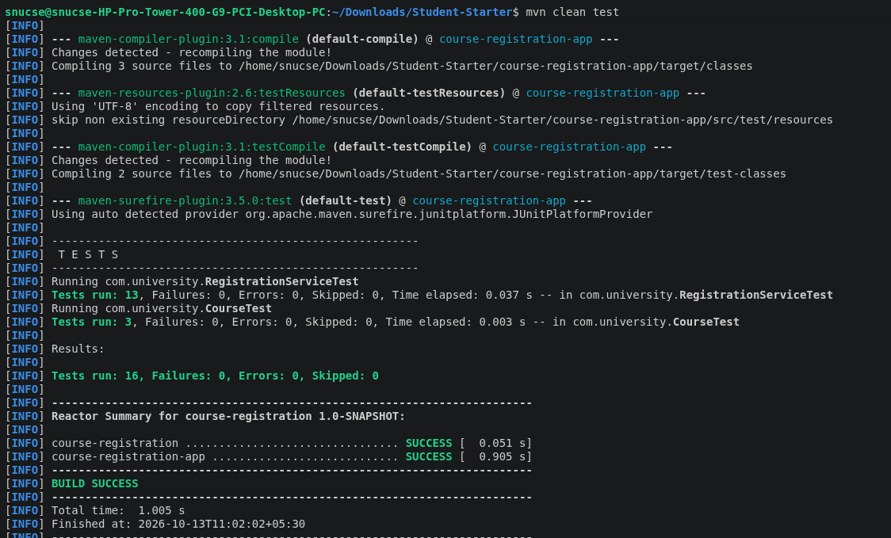